<div align="center">

# ☁️ Obligatorio · Implementación de Soluciones Cloud

**Migración a AWS de un e-commerce on-premise, con toda la infraestructura automatizada en Terraform**


Analista en Infraestructura Informática · ORT Uruguay · Guillermo Chaves · Diciembre 2026



</div>

## Contenido

1. [Descripción](#descripción)
2. [La aplicación: Tienda de la nube](#la-aplicación-tienda-de-la-nube)
3. [Cumplimiento de requisitos](#cumplimiento-de-requisitos)
4. [Arquitectura](#arquitectura)
5. [Servicios de AWS usados](#servicios-de-aws-usados)
6. [Requerimientos y versiones](#requerimientos-y-versiones)
7. [Estructura del repositorio](#estructura-del-repositorio)
8. [Instructivo de uso](#instructivo-de-uso)
9. [Variables](#variables)
10. [Trabajo colaborativo](#trabajo-colaborativo)
11. [Uso de inteligencia artificial](#uso-de-inteligencia-artificial)

## Descripción

**Contexto.** Una empresa de venta online con infraestructura on-premise sufrió una degradación de performance tras una campaña publicitaria que llevó el tráfico de su e-commerce a valores fuera de lo previsto. Decidió migrar el frontend de su solución a AWS.

**Objetivo.** Diseñar e implementar en AWS, mediante Terraform, una solución equivalente a la actual (load balancer, dos servidores de aplicación, base de datos y respaldos) que sea tolerante a fallas, soporte picos de tráfico y tenga el firewall restringido al máximo.

## La aplicación: Tienda de la nube

Un e-commerce de remeras para gente que vive en la terminal, con estética de consola. Está escrito en PHP, corre sobre Apache en los servidores de aplicación y guarda productos y pedidos en la base de datos RDS.

- **Barra de estado** al pie: instancia y AZ que respondió, estado de la base y latencia.
- **Log de pedidos:** cada compra registra qué instancia y qué AZ la atendió.
- **Stock en vivo:** la compra descuenta stock dentro de una transacción.

Los servidores descargan la aplicación (`app/`) desde este repositorio al arrancar. Detalle en [docs/arquitectura.md](docs/arquitectura.md#aplicación).

## Cumplimiento de requisitos

| Requisito | Cómo se resuelve |
|---|---|
| **3.a** Componentes de la solución actual | **Load balancer:** Application Load Balancer público. **Dos servidores de aplicación:** Auto Scaling Group con capacidad deseada 2. **Base de datos:** RDS MySQL. **Respaldos:** backups automáticos de RDS con restauración a cualquier momento de los últimos 7 días |
| **3.b** Tolerancia a fallas | Todo duplicado en 2 zonas de disponibilidad: subredes, NAT Gateway (uno por AZ) y servidores. El load balancer saca de servicio a un servidor que no responde y el Auto Scaling Group lo reemplaza. RDS Multi-AZ con failover automático y el mismo endpoint |
| **3.c** Picos de tráfico | El Auto Scaling Group agrega servidores (hasta 4) para mantener la CPU promedio en 50 %. Monitoreo detallado (métricas cada 1 minuto) |
| **3.d** Firewall restringido al máximo | Security groups encadenados por capa, con entrada y salida restringidas. Servidores sin IP pública, base de datos sin ruta a Internet, SSH solo a través del bastion y solo desde la IP del administrador |
| **3.e** Mejoras | Monitoreo con CloudWatch: 4 alarmas con aviso por email (SNS) y un dashboard con las métricas de las tres capas. Aplicación propia que hace visible el balanceo y el uso de la base |

## Arquitectura

La solución se organiza en tres capas, repartidas en dos zonas de disponibilidad (`us-east-1a` y `us-east-1b`):

- **Publicación (subredes públicas):** load balancer, bastion y NAT Gateways.
- **Aplicación (subredes privadas):** servidores de la tienda en un Auto Scaling Group, sin IP pública.
- **Persistencia (subredes de datos):** base de datos RDS MySQL Multi-AZ, sin ruta a Internet.

Detalle completo (direccionamiento, reglas de firewall, base de datos, respaldos, monitoreo y aplicación) en [docs/arquitectura.md](docs/arquitectura.md).

## Servicios de AWS usados

| Servicio | Uso en la solución |
|---|---|
| Amazon VPC | Red aislada con 6 subredes en 2 AZ, Internet Gateway, 2 NAT Gateway y tablas de ruteo |
| Amazon EC2 | Servidores de aplicación y bastion, security groups, launch template, Elastic IPs |
| Elastic Load Balancing | Application Load Balancer, listener y target group con health check |
| EC2 Auto Scaling | Auto Scaling Group y política de escalado por CPU |
| Amazon RDS | Base de datos MySQL Multi-AZ y backups automáticos |
| Amazon CloudWatch | Métricas, 4 alarmas y dashboard |
| Amazon SNS | Envío por email de las alertas de CloudWatch |

## Requerimientos y versiones

| Herramienta | Versión | Para qué |
|---|---|---|
| Terraform | `>= 1.16.5` | Despliegue |
| Provider `hashicorp/aws` | `~> 6.68` | Recursos de AWS |
| AWS CLI | v2 | Credenciales y verificación de la sesión |
| Git | Reciente | Clonar el repositorio |
| Cliente SSH | OpenSSH | Acceso administrativo a través del bastion |
| Cuenta AWS | AWS Academy Learner Lab | Región `us-east-1`, key pair `vockey` |

Software en los servidores (lo instala el user-data): Amazon Linux 2023, Apache, PHP con `php-mysqlnd` y Git. Base de datos: MySQL 8.0.

## Estructura del repositorio

```
obligatorio-isc/
├── README.md                   Esta documentación
├── providers.tf                Versiones de Terraform y del provider, región
├── main.tf                     Llamada a los módulos y conexión entre ellos
├── variables.tf                Variables de la raíz con sus valores por defecto
├── outputs.tf                  Datos que se muestran al terminar el despliegue
├── terraform.tfvars.ejemplo    Plantilla de los valores necesarios
├── .gitignore                  Excluye estado, .terraform/, tfvars y claves
├── app/                        Aplicación web (la descargan los servidores al arrancar)
│   ├── index.php               Tienda: catálogo, compras y log de pedidos
│   └── img/                    Imágenes de los productos
├── docs/
│   ├── arquitectura.md         Detalle técnico de la infraestructura
│   └── arquitectura.drawio.svg Diagrama de arquitectura
└── modules/
    ├── network/                VPC, subredes, Internet Gateway, NAT Gateways y ruteo
    ├── security/               Security groups
    ├── compute/                Load balancer, launch template, Auto Scaling Group, bastion y user-data
    ├── database/               RDS MySQL Multi-AZ y respaldos
    └── monitoring/             Alarmas, notificaciones y dashboard de CloudWatch
```

Cada módulo tiene tres archivos (a excepción de compute.tf, que además incluye userdata.tpl, la plantilla del script de arranque): los recursos (`network.tf`), las variables que recibe (`netvars.tf`) y los datos que expone (`netoutputs.tf`). Los módulos se conectan a través de `main.tf`.

## Instructivo de uso

### 1. Preparación

1. Instalar Terraform, AWS CLI v2 y Git.
2. Clonar el repositorio:
   ```bash
   git clone https://github.com/guicharod/obligatorio-isc.git
   cd obligatorio-isc
   ```
3. Crear el archivo de valores locales a partir de la plantilla:
   ```bash
   cp terraform.tfvars.ejemplo terraform.tfvars
   ```
4. Completar `terraform.tfvars`:

   | Valor | Qué poner |
   |---|---|
   | `ip_admin` | IP pública del administrador en formato `x.x.x.x/32` |
   | `db_password` | Contraseña de la base: mínimo 8 caracteres |
   | `email_alertas` | Mail que recibe las alertas |

   `terraform.tfvars` está en `.gitignore`: nunca se sube al repositorio.

### 2. Credenciales a AWS

1. Obtenerlas directo desde AWS o en Academy Lab: **Start Lab** → **AWS Details** → **AWS CLI: Show**.
2. Pegar el bloque en `~/.aws/credentials`.

### 3. Despliegue

```bash
terraform init
terraform plan
terraform apply
```

El despliegue completo puede tardar hasta 20 minutos (la base de datos Multi-AZ es lo más lento). Al terminar:

1. Llega un mail **"AWS Notification - Subscription Confirmation"**: hacer clic en **Confirm subscription** para recibir las alertas.
2. Esperar unos 5 minutos a que los servidores instalen la aplicación.

### 4. Outputs

| Output | Contenido |
|---|---|
| `url_sitio` | URL de la tienda (DNS del load balancer) |
| `ip_bastion` | IP pública del bastion |
| `ips_privadas_app` | IPs privadas de los servidores de aplicación al momento del despliegue |
| `db_endpoint` | Endpoint de la base de datos |
| `url_dashboard` | Link al dashboard de CloudWatch |

### 5. Acceso administrativo

Los servidores de aplicación no tienen IP pública: se accede saltando por el bastion, sin copiar la clave al servidor.

```bash
# Al bastion
ssh -i labsuser.pem ec2-user@IP_BASTION

# A un servidor de aplicación, a través del bastion
ssh -i labsuser.pem -o ProxyCommand="ssh -i labsuser.pem -W %h:%p ec2-user@IP_BASTION" ec2-user@IP_PRIVADA_APP
```

El acceso por SSH solo funciona desde la IP cargada en `ip_admin`.

### 6. Eliminación

```bash
terraform destroy
```

## Variables

| Variable | Valor por defecto | Descripción |
|---|---|---|
| `nombreproyecto` | `obligatorio-isc` | Prefijo de nombres y tags |
| `region` | `us-east-1` | Región de las métricas del dashboard |
| `vpc_cidr` | `10.0.0.0/16` | Rango de la VPC |
| `az_a`, `az_b` | `us-east-1a`, `us-east-1b` | Zonas de disponibilidad |
| `cidr_public_a`, `cidr_public_b` | `10.0.0.0/24`, `10.0.1.0/24` | Subredes públicas |
| `cidr_app_a`, `cidr_app_b` | `10.0.10.0/24`, `10.0.11.0/24` | Subredes de aplicación |
| `cidr_db_a`, `cidr_db_b` | `10.0.20.0/24`, `10.0.21.0/24` | Subredes de datos |
| `ip_admin` | Sin valor (va en `terraform.tfvars`) | IP del administrador para SSH al bastion |
| `puerto_app` | `80` | Puerto de la aplicación |
| `puerto_db` | `3306` | Puerto de la base de datos (MySQL) |
| `instance_type` | `t3.micro` | Tamaño de las instancias |
| `key_name` | `vockey` | Key pair para SSH |
| `asg_min`, `asg_deseado`, `asg_max` | `2`, `2`, `4` | Capacidad del Auto Scaling Group |
| `db_instance_class` | `db.t3.micro` | Tamaño de la base de datos |
| `db_nombre` | `bdoblig` | Nombre de la base |
| `db_usuario` | `admin` | Usuario administrador de la base |
| `db_password` | Sin valor (va en `terraform.tfvars`) | Contraseña de la base (variable sensible) |
| `db_backup_retencion` | `7` | Días que se conservan los backups automáticos |
| `db_skip_final_snapshot` | `true` | `true`: no guarda snapshot al destruir (desarrollo). En producción, `false` |
| `email_alertas` | Sin valor (va en `terraform.tfvars`) | Mail que recibe las alertas |
| `app_repo_url` | URL de este repositorio | Repositorio desde el que se descarga la aplicación |
| `app_branch` | `main` | Rama de la aplicación a desplegar |

## Trabajo colaborativo

Se usó una rama por cada parte de la infraestructura, integrada a `main` mediante pull request.

| Rama | Contenido |
|---|---|
| `base` | Estructura del repositorio |
| `network` | VPC, subredes, ruteo y NAT Gateways |
| `security` | Security groups |
| `compute` | Load balancer, Auto Scaling Group, escalado y bastion |
| `docs` | Primera documentación y diagrama |
| `database` | RDS Multi-AZ y respaldos |
| `monitoring` | Alarmas, SNS y dashboard de CloudWatch |
| `app` | Aplicación Tienda de la nube y despliegue desde Git |
| `docs-final` | Documentación completa |

Buenas prácticas aplicadas: código siempre formateado con `terraform fmt` y validado con `terraform validate` antes de cada commit, comentarios en cada recurso, y valores sensibles (contraseñas, IP, estado de Terraform) fuera del repositorio con .gitignore.

## Uso de inteligencia artificial

| Herramienta | Etapa | Contexto de uso |
|---|---|---|
| Claude | Análisis y planificación | Análisis del objetivo y plan de iteraciones |
| Claude | Aplicación | Generación del código de la tienda (PHP) y del script de arranque |
| Claude | Pruebas | Guía para las pruebas por requisito y ayuda con diagnóstico de problemas (timeouts de SSH, permisos del Learner Lab, failover) |
| Claude | Documentación | Borrador de la estructura, contenido de la documentación y mejoras en diagrama |

---
GC.
