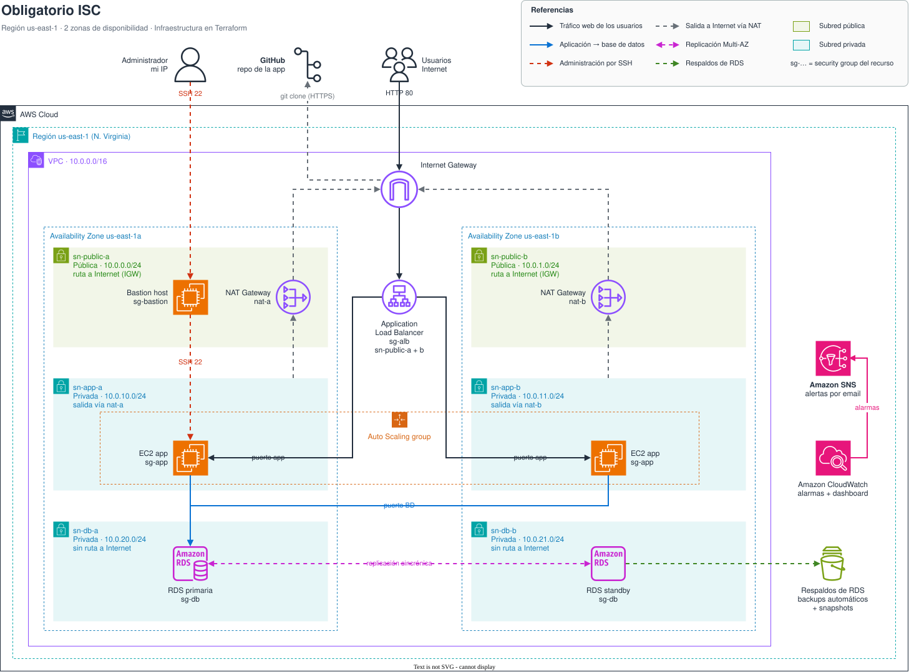
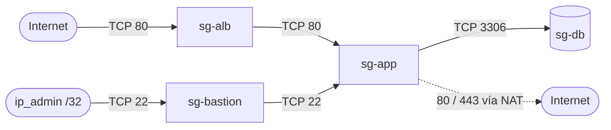
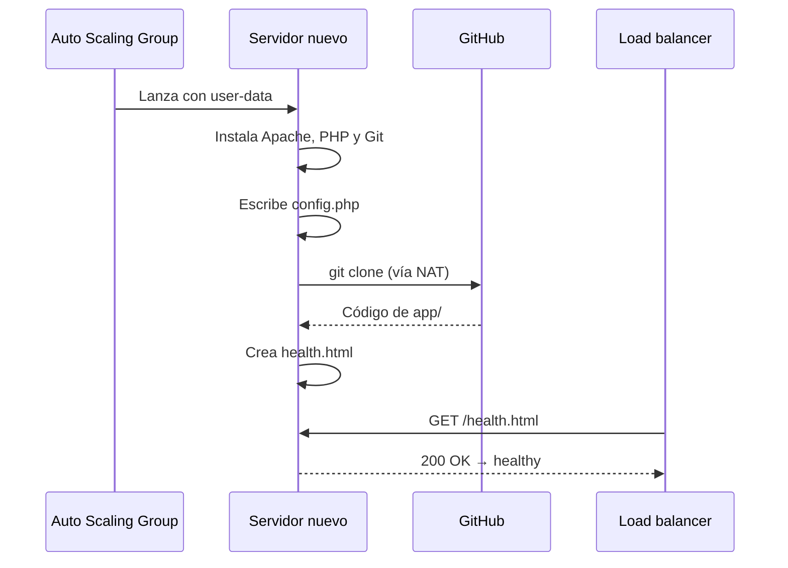

# 🏗️ Arquitectura

**Detalle técnico de la infraestructura en AWS**

[← Volver al README](../README.md)

## Contenido

1. [Diagrama](#diagrama)
2. [Capas](#capas)
3. [Flujos de tráfico](#flujos-de-tráfico)
4. [Red](#red-modulesnetwork)
5. [Firewall](#firewall-modulessecurity)
6. [Cómputo](#cómputo-modulescompute)
7. [Base de datos](#base-de-datos-modulesdatabase)
8. [Respaldos](#respaldos-modulesdatabase)
9. [Monitoreo](#monitoreo-modulesmonitoring)
10. [Aplicación](#aplicación-app)

## Diagrama

---

## Capas

| Capa | Subredes | Componentes | Acceso a Internet |
|---|---|---|---|
| **Publicación** | `sn-public-a`, `sn-public-b` | Load balancer, NAT Gateways, bastion | Directo, por el Internet Gateway |
| **Aplicación** | `sn-app-a`, `sn-app-b` | Servidores de la tienda (Auto Scaling Group) | Solo saliente, por el NAT Gateway de su AZ. Sin IP pública |
| **Persistencia** | `sn-db-a`, `sn-db-b` | RDS MySQL Multi-AZ (primaria y standby) | Ninguno |

Cada capa está duplicada en las dos zonas de disponibilidad, `us-east-1a` y `us-east-1b`.

---

## Flujos de tráfico

| Flujo | Recorrido |
|---|---|
| **Cliente** | Internet → Internet Gateway → load balancer (HTTP 80) → servidor de aplicación de cualquiera de las dos AZ → base de datos (TCP 3306) |
| **Salida de los servidores** | Servidor de aplicación → NAT Gateway de su AZ → Internet Gateway → Internet. Solo para instalar paquetes y descargar la aplicación desde GitHub (HTTP 80 y HTTPS 443) |
| **Administración** | IP del administrador → bastion (SSH 22) → servidor de aplicación (SSH 22) |
| **Replicación de la base** | RDS primaria → RDS standby en la otra AZ (sincrónica, administrada por AWS) |
| **Alertas** | Métricas → alarmas de CloudWatch → topic de SNS → email |

---

## Red (`modules/network`)

**VPC:** `10.0.0.0/16`, con resolución y nombres DNS habilitados (los necesita RDS).

| Subred | CIDR | AZ | Tipo | Tabla de ruteo | Ruta `0.0.0.0/0` | Contiene |
|---|---|---|---|---|---|---|
| `sn-public-a` | `10.0.0.0/24` | us-east-1a | Pública | `rt-public` | Internet Gateway | Load balancer, NAT Gateway a, bastion |
| `sn-public-b` | `10.0.1.0/24` | us-east-1b | Pública | `rt-public` | Internet Gateway | Load balancer, NAT Gateway b |
| `sn-app-a` | `10.0.10.0/24` | us-east-1a | Privada | `rt-app-a` | NAT Gateway a | Servidores de aplicación |
| `sn-app-b` | `10.0.11.0/24` | us-east-1b | Privada | `rt-app-b` | NAT Gateway b | Servidores de aplicación |
| `sn-db-a` | `10.0.20.0/24` | us-east-1a | Privada | `rt-db` | Sin ruta | RDS |
| `sn-db-b` | `10.0.21.0/24` | us-east-1b | Privada | `rt-db` | Sin ruta | RDS |

- **Dos NAT Gateways**, uno por AZ, cada uno con su Elastic IP. Cada subred de aplicación sale por el NAT de su propia AZ: si se cae una zona, la otra conserva su salida a Internet.
- Las subredes de datos solo tienen la ruta local de la VPC: la base de datos no tiene entrada ni salida a Internet.
- Los rangos de la VPC y de cada subred son variables (`vpc_cidr`, `cidr_*`).

---

## Firewall (`modules/security`)

Los security groups están **encadenados**: en lugar de permitir rangos de IP, cada capa acepta tráfico solo desde el security group de la capa anterior.

| Security group | Entrada | Salida |
|---|---|---|
| `sg-alb` | TCP 80 desde `0.0.0.0/0` | TCP 80 (puerto de la app) solo hacia la VPC |
| `sg-bastion` | TCP 22 solo desde `ip_admin` (una sola IP, `/32`) | TCP 22 solo hacia la VPC |
| `sg-app` | TCP 80 desde `sg-alb`; TCP 22 desde `sg-bastion` | TCP 80 y 443 a Internet (vía NAT); TCP 3306 hacia la VPC |
| `sg-db` | TCP 3306 desde `sg-app` | Ninguna |

- **Salida restringida en todos los grupos:** el bastion no puede salir a Internet, y la base de datos no puede iniciar ninguna conexión. Como los security groups son *stateful*, las respuestas a conexiones permitidas salen igual, sin necesitar una regla de salida.
- **Acceso SSH en dos capas:** solo la IP del administrador llega al puerto 22 del bastion, y además se necesita la clave privada (`vockey`). Los servidores de aplicación solo aceptan SSH desde el bastion.

---

## Cómputo (`modules/compute`)

| Componente | Configuración |
|---|---|
| AMI | Amazon Linux 2023 x86_64, la más reciente (datasource `aws_ami`) |
| Tipo de instancia | `t3.micro` (variable `instance_type`) |
| Key pair | `vockey` (Learner Lab) |
| Launch template | `lt-app`: AMI, tipo de instancia, key pair, `sg-app`, monitoreo detallado (métricas cada 1 minuto) y user-data generado desde la plantilla `userdata.tpl` |
| Auto Scaling Group | `asg-app`: mínimo 2, deseado 2, máximo 4, repartido en `sn-app-a` y `sn-app-b`. Usa el health check del load balancer, con 300 segundos de gracia para que la instancia termine de instalarse |
| Escalado | Target tracking sobre la CPU promedio del grupo, objetivo 50 %. AWS crea automáticamente dos alarmas (`AlarmHigh` y `AlarmLow`) para agregar o quitar instancias |
| Load balancer | Application Load Balancer público en las dos subredes públicas, listener HTTP 80 |
| Target group | `tg-app`, puerto 80. Health check en `/health.html` cada 10 segundos; 2 fallas seguidas = unhealthy |
| Bastion | Instancia `t3.micro` en `sn-public-a`, con `sg-bastion` |

El health check usa /health.html porque la página principal consulta la base de datos. Si el health check dependiera de la BD, una caída breve de la base (por ejemplo durante un failover) haría fallar a todos los servidores a la vez, y el Auto Scaling Group los reemplazaría a todos innecesariamente.

---

## Base de datos (`modules/database`)

| Parámetro | Valor |
|---|---|
| Motor | MySQL 8.0 |
| Clase de instancia | `db.t3.micro` |
| Almacenamiento | 20 GB |
| Alta disponibilidad | **Multi-AZ**: instancia primaria en una AZ y standby con replicación sincrónica en la otra |
| Subnet group | `dbsng`: `sn-db-a` y `sn-db-b` |
| Security group | `sg-db` |
| Acceso público | No (`publicly_accessible = false`) |
| Base inicial | `bdoblig` (variable `db_nombre`) |
| Usuario | `admin` (variable `db_usuario`) |
| Contraseña | Variable `db_password`, marcada como `sensitive` y cargada desde `terraform.tfvars` |

**Failover:** si la primaria falla, RDS promueve la standby automáticamente. El endpoint no cambia, así que la aplicación se reconecta sola sin modificar su configuración.

---

## Respaldos (`modules/database`)

Los servidores de aplicación son *stateless*: no guardan datos propios y el Auto Scaling Group los recrea desde el launch template. El código y la infraestructura están versionados en Git. Por eso, el único dato a respaldar es la base de datos.

| Parámetro | Valor |
|---|---|
| Tipo | Backups automáticos de RDS: copia diaria más logs de transacciones |
| Retención | 7 días (variable `db_backup_retencion`, de 1 a 35) |
| Ventana de backup | 03:00 a 04:00 UTC. En Multi-AZ se toma desde la standby, sin impacto en la primaria |
| Ventana de mantenimiento | Domingos de 05:00 a 06:00 UTC (no se superpone con la de backup) |
| Restauración | *Point-in-time*: a cualquier segundo dentro de los 7 días. Crea una base nueva sin tocar la original |
| Snapshot final | Configurable con `db_skip_final_snapshot`. En desarrollo está en `true` para no acumular snapshots en el lab; en producción iría en `false`, para que al eliminar la base quede el snapshot `obligatorio-isc-db-final` |
| Tags | Los snapshots heredan los tags de la base (`copy_tags_to_snapshot`) |

---

## Monitoreo (`modules/monitoring`)

Se envian alertas por email a través del topic de SNS `obligatorio-isc-sns-alertas`. Las dos de la aplicación también avisan cuando vuelven a la normalidad.

| Alarma | Métrica | Condición | Qué detecta |
|---|---|---|---|
| `obligatorio-isc-app-cpu-alta` | CPU promedio del Auto Scaling Group | > 70 % durante 2 minutos | Pico de tráfico |
| `obligatorio-isc-app-unhealthy` | Targets unhealthy del load balancer | ≥ 1 durante 1 minuto | Un servidor dejó de responder |
| `obligatorio-isc-db-cpu-alta` | CPU de RDS | > 80 % durante 5 minutos | Base sobrecargada |
| `obligatorio-isc-db-storage-bajo` | Espacio libre en RDS | < 2 GB | Base quedándose sin disco |

### Dashboard

`obligatorio-isc-dashboard` (link en el output `url_dashboard`), con 6 gráficos:

| Gráfico | Métricas |
|---|---|
| Load balancer: peticiones | `RequestCount` |
| Load balancer: servidores sanos y no sanos | `HealthyHostCount`, `UnHealthyHostCount` |
| App: CPU promedio | `CPUUtilization` del Auto Scaling Group |
| App: cantidad de instancias | `GroupInServiceInstances`, `GroupDesiredCapacity` |
| Base de datos: CPU y conexiones | `CPUUtilization`, `DatabaseConnections` |
| Base de datos: espacio libre | `FreeStorageSpace` |

---
## Aplicación (`/app`)

**Tienda de la nube:** un e-commerce de remeras con estética de consola, escrito en PHP.

### Despliegue

Cuando el Auto Scaling Group lanza un servidor nuevo, Terraform le pasa un script de arranque (*user-data*), generado a partir de la plantilla `userdata.tpl`. El script hace lo siguiente:

1. Instala Apache, PHP y Git.
2. Crea `/var/www/config.php` con los datos de conexión a la base, el ID de la instancia y su AZ.
3. Descarga la aplicación con `git clone` desde GitHub (rama `app_branch`). La salida a Internet es por el NAT Gateway de su AZ.
4. Copia la carpeta `app/` a `/var/www/html`.
5. Crea `health.html`, **solo si la descarga funcionó**. Si falló, el load balancer marca el servidor como *unhealthy* y el Auto Scaling Group lo reemplaza.

- La configuración (endpoint, usuario y contraseña de la base) se escribe en `/var/www/config.php`, **fuera** de la carpeta pública, para que no se pueda descargar desde el navegador.

### Funcionamiento

| Función | Detalle |
|---|---|
| Catálogo | Definido en el bloque `$catalogo` de `app/index.php`: nombre, descripción, precio, stock inicial y dos imágenes por producto |
| Tablas | La aplicación las crea si no existen: `productos` y `pedidos` |
| Carga del catálogo | Crea los productos nuevos y actualiza nombre, descripción y precio de los existentes, sin tocar el stock |
| Compra | Transacción: descuenta stock y registra el pedido con la instancia y la AZ que lo atendió. Si no hay stock, no registra nada |
| Log de pedidos | Últimos 8 pedidos, con la instancia y la AZ de cada uno |
| Barra de estado | Instancia, AZ, estado de la base y latencia de la conexión |
| Base no disponible | Muestra un aviso en lugar de fallar (por ejemplo, durante un failover) |