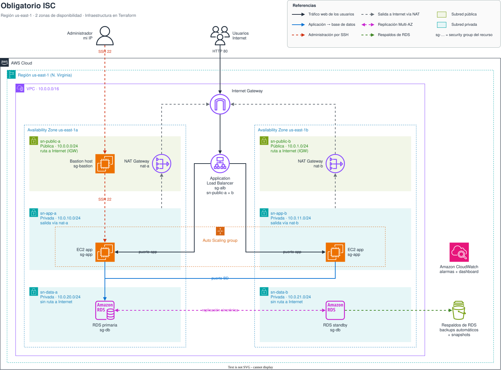

## Diagrama

   

## Capas

- **Publicación (subredes públicas):** load balancer, bastion y los dos NAT Gateway. Única capa con ruta directa a Internet.
- **Aplicación (subredes privadas):** servidores de app administrados por un Auto Scaling Group, una instancia por AZ. Sin IP pública; salen a Internet por el NAT de su AZ.

## Flujos

- **Cliente:** Internet → Internet Gateway → load balancer (80) → servidores de app → base de datos (3306).
- **Salida de los servidores** Servidor de app → NAT Gateway → Internet Gateway → Internet (solo para instalación de paquetes y de la aplicación) 
- **Administración:** IP del administrador → Bastion (SSH 22) → servidor de app (SSH 22).

## Datos de la infraestructura

### Red (modules/networking)

**VPC:** `10.0.0.0/16`, con resolución y nombres DNS habilitados.

| Subred | CIDR | AZ | Tipo | Tabla de ruteo | Ruta `0.0.0.0/0` | Contiene |
|---|---|---|---|---|---|---|
| `sn-public-a` | `10.0.0.0/24` | us-east-1a | Pública | `rt-public` | Internet Gateway | Load balancer, NAT Gateway a, bastion |
| `sn-public-b` | `10.0.1.0/24` | us-east-1b | Pública | `rt-public` | Internet Gateway | Load balancer, NAT Gateway b |
| `sn-app-a` | `10.0.10.0/24` | us-east-1a | Privada | `rt-app-a` | NAT Gateway a | Servidores de aplicación |
| `sn-app-b` | `10.0.11.0/24` | us-east-1b | Privada | `rt-app-b` | NAT Gateway b | Servidores de aplicación |
| `sn-db-a` | `10.0.20.0/24` | us-east-1a | Privada | `rt-db` | Sin ruta | Base de datos (RDS) |
| `sn-db-b` | `10.0.21.0/24` | us-east-1b | Privada | `rt-db` | Sin ruta | Base de datos (RDS) |

- VPC `10.0.0.0/16` con resolución DNS habilitado.
- Dos NAT Gateway, cada uno con su Elastic IP, uno por AZ. Cada subred de app sale por el NAT de su propia AZ.

### Cómputo (modules/compute)

| Componente | Configuración |
|---|---|
| AMI | Amazon Linux 2023 x86_64, la más reciente (datasource `aws_ami`) |
| Tipo de instancia | `t3.micro` (variable `instance_type`) |
| Key pair | `vockey` (Learner Lab) |
| Launch template | `lt-app`: AMI, tipo de instancia, key pair, `sg-app` y user-data (`userdata.sh`) |
| Auto Scaling Group | `asg-app`: mínimo 2, deseado 2, máximo 4, en `sn-app-a` y `sn-app-b`. |
| Escalado | Tracking sobre el CPU promedio del ASG, objetivo 50 % |
| Load balancer | Application Load Balancer público, listener HTTP 80, target group `tg-app` |
| Bastion | Instancia `t3.micro` en `sn-public-a`, con `sg-bastion` |
| Aplicación | Provisoria: Apache con una página que muestra el ID de instancia y la AZ |

### Firewall (modules/security)

| Security group | Entrada | Salida |
|---|---|---|
| `sg-alb` | TCP 80 desde `0.0.0.0/0` | TCP puerto de la app (80) hacia la VPC |
| `sg-bastion` | TCP 22 solo desde `ip_admin` (/32) | TCP 22 hacia la VPC |
| `sg-app` | TCP puerto de la app desde `sg-alb`; TCP 22 desde `sg-bastion` | TCP 80 y 443 a Internet (vía NAT); TCP 3306 hacia la VPC |
| `sg-db` | TCP 3306 desde `sg-app` | Ninguna |

### Base de datos (modules/database)

### Respaldos (modules/database)

### Monitoreo